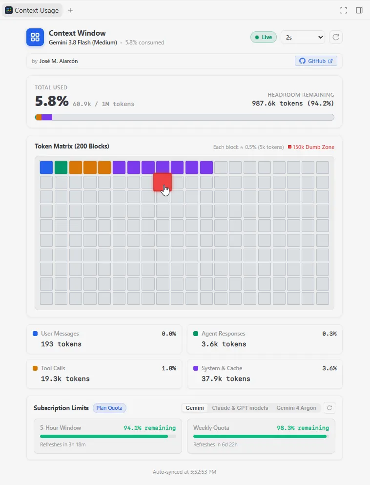
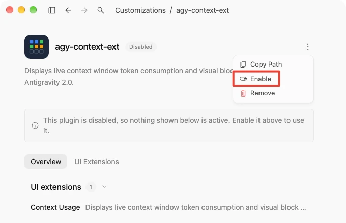
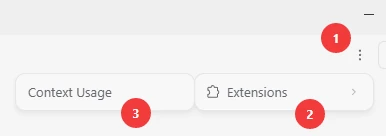
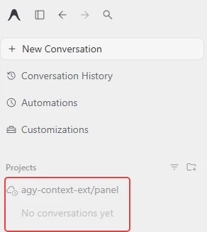

# Context Usage Extension for Antigravity 2

**by [José M. Alarcón](https://github.com/jmalarcon)** - Source code at [GitHub](https://github.com/jmalarcon/AGY-ContextExt)

## 1. Description

AGY-ContextExt is a User Interface (UI) extension plugin for the **Google Antigravity 2** desktop application (AGY).

This extension shows live data about AGY's current conversation **context window usage** and **subscription rate limits**:



The extension shows:

- The name of the active model.
- The total used tokens and the maximum token capacity.
- The total percentage of the used context window.
- The remaining free headroom tokens.
- A visual progress bar with color segments for each data category.
- A visual matrix with 200 colored blocks (each block represents 0.5% of the context window).
- A breakdown of tokens by category:
  - User messages
  - Agent responses
  - Tool calls and outputs
  - System instructions and cache
- Subscription rate limits by family of models:
  - 5-hour rolling refresh window usage and remaining tokens.
  - Weekly quota usage and remaining tokens.
  - Automatic light/dark mode based on the AGY theme.
- Configurable refresh interval and manual refresh mode:
  - Choose any interval from 1 to 60 seconds, or choose 0 for manual refresh mode. Default is 2s.
  - The indicator shows green "Live" during active polling, and switches to red "Manual" when the interval is 0.
  - A refresh button allows manual updates at any time.
- Model quotas information updates every 2 minutes (cached to prevent API rate limits). You can manually update it using the refresh button at the top-right corner.

## 2. Requirements

Before you install this extension, make sure that you have:

- [Antigravity 2](https://antigravity.google/product/antigravity-2) desktop application installed on your computer.
- Read access to your user configuration directory:
  - Windows: `%USERPROFILE%\.gemini\config\`
  - macOS and Linux: `~/.gemini/config/`
- [Antigravity CLI](https://antigravity.google/product/antigravity-cli) installed if you want to see the current model usage quota information at the bottom of the extension UI.

## 3. Installation Procedure

Follow these steps to install the plugin into Antigravity 2:

1. **IMPORTANT**: Close the Antigravity 2 app.

2. Locate your global Antigravity plugins directory:

   - On Windows: `%USERPROFILE%\.gemini\config\plugins\`
   - On macOS and Linux: `~/.gemini/config/plugins/`

   If the `plugins` folder does not exist, create it.

3. Create a folder named `agy-context-ext` inside the `plugins` directory.

4. Copy all files from the `src` directory of this repository into the `agy-context-ext` directory.

Or you can run the following commands from the root directory of this repository to achieve the same result:

- **Windows (PowerShell)**:

   ```powershell
   Copy-Item -Path ".\src\*" -Destination "$env:USERPROFILE\.gemini\config\plugins\agy-context-ext\" -Recurse -Force
   ```

- **macOS and Linux (Terminal)**:

   ```bash
   mkdir -p ~/.gemini/config/plugins/agy-context-ext
   cp -R ./src/* ~/.gemini/config/plugins/agy-context-ext/
   ```

## 4. Activation Procedure

Follow these steps to make sure the extension is installed and enabled in Antigravity:

1. Start the Antigravity 2 desktop application. If Antigravity was open when you copied the files, restart the application.

2. In the left navigation bar, click **Customizations**.

3. Click the **Installed** tab.

4. Find **Context Usage** in the list.

5. Move the toggle switch to **ON**. Antigravity starts the background sidecar process.



## 5. Usage

Follow these steps to display the extension during a conversation:

1. Open any chat conversation in Antigravity, even a new empty one.

2. In the top-right corner of the conversation window, click the **⋮** (three dots) menu button.

3. Move your pointer over **Extensions**.

4. Click **Context Usage**.



The extension opens in the right side pane (Auxiliary Pane). The panel monitors your conversation and shows the live context usage in (almost) real time.

> [!NOTE]
> In the Antigravity left sidebar, an item named `agy-context-ext/panel` displays automatically:
>
>
>
>This is normal. Antigravity displays active background sidecar processes for user security and process visibility. You do not need to pay attention to it or perform any action on it. Just ignore it.

## 6. Color Reference

The extension uses the following color codes:

| Color | Category | Meaning |
| :--- | :--- | :--- |
| **Blue** (`#2563eb`) | User Messages | Tokens from user inputs |
| **Green** (`#059669`) | Agent Responses | Tokens from agent thoughts and messages |
| **Amber** (`#d97706`) | Tool Calls | Tokens from tool execution calls and tool results |
| **Purple** (`#7c3aed`) | System & Cache | Tokens from system prompts, rules, and cache |
| **Light Slate** | Free Space | Available unused token capacity |

## 7. Troubleshooting

### Problem: The panel is blank or shows an error

- **Cause**: The sidecar process did not start correctly.
- **Solution**: Open **Customizations** -> **Installed**. Turn the **Context Usage** switch to **OFF**, wait 2 seconds, and turn it to **ON**.

### Problem: The panel does not show changes after an update

- **Cause**: The application cached the previous web view in memory.
- **Solution**: Close and restart the Antigravity desktop application.
